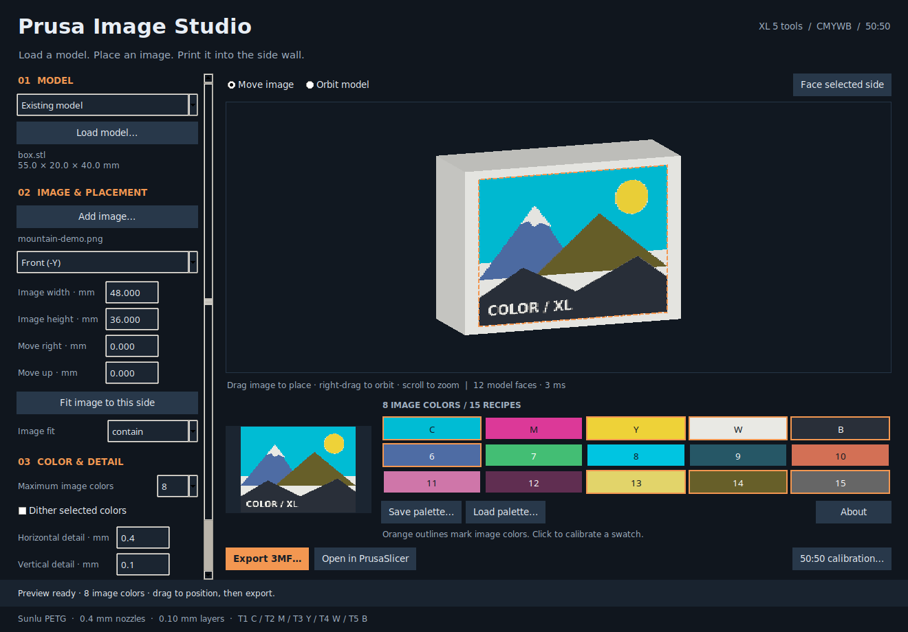

# Prusa Image Studio

A local desktop editor that puts an image on a model's vertical wall and exports a **native PrusaSlicer 3 ColorMix project**. It supports existing STL/OBJ/3MF geometry and new upright picture panels.

Designed for an **Original Prusa XL, five standard-flow 0.4 mm nozzles, Sunlu PETG**, with **T1 cyan / T2 magenta / T3 yellow / T4 white / T5 black**. The palette offers the five physical filaments and all ten **50:50** pairs. Blends use actual virtual extruders; PrusaSlicer alternates their constituent tools by layer.

Version **0.2.1** has a model-first workflow, continuous texture previews, direct image dragging, selectable color quantization, and independent horizontal/vertical detail. It fixes the Linux file-picker crash present in 0.2.0. Tested on Linux with **PrusaSlicer 3.0.0-alpha13**. This is an independent project, not affiliated with Prusa Research.



## Install and launch

Python 3.12+, Tk, and desktop OpenGL 3.3 are required. On Ubuntu/Mint:

```sh
sudo apt install python3-venv python3-tk libgl1-mesa-dri libglx-mesa0
git clone https://github.com/PraxisOG/prusa-image-studio.git
cd prusa-image-studio
python3 -m venv .venv
.venv/bin/pip install -e '.[test]'
./launch.sh
```

Optionally install an Applications-menu launcher for this checkout:

```sh
.venv/bin/python scripts/install_launcher.py
```

Linux defaults to Mesa software rendering for predictable driver behavior. The preview draws the original model with a texture, which is fast even without hardware acceleration. `PRUSA_IMAGE_HARDWARE_GL=1 ./launch.sh` opts into your desktop hardware driver. Windows/macOS are not yet validated. The CLI can generate projects without a display.

## Place an image

1. **Load model**. Its geometry appears immediately, before choosing an image. Alternatively, choose **Picture panel** and set the panel dimensions.
2. **Add image**. The image initially fits the selected side with a small margin and preserves its aspect ratio.
3. **Drag with the left mouse button** to position the image. It follows the pointer. **Right-drag** to orbit the model, scroll to zoom, and double-click or use **Face selected side** to look straight at the image. The toolbar also lets the left button orbit.
4. Choose front, back, right, or left. Image width, height, and right/up offsets are editable in millimetres. `contain` preserves the whole image, `cover` crops to fill, and `stretch` fills without preserving aspect ratio.
5. Set **Maximum image colors** from **1 to 15**. The editor selects a suitable subset of the printable recipes using perceptual color distance. Optional ordered dithering uses only that subset. Orange swatch outlines identify the recipes used by the image.
6. Set horizontal and vertical detail independently. Defaults are **0.4 mm × 0.1 mm**; both accept **0.10–5 mm**. Vertical detail follows the 0.10 mm layers. A complete 50:50 alternation spans two layers; very small horizontal marks may not resolve through a 0.4 mm nozzle.
7. **Export 3MF**, then **Open in PrusaSlicer**. When opening manually, use **File → Open Project** to retain the blends and printer configuration.

The color setting is a maximum: an image may need fewer colors. The white model body is additional unless white is already among the image's colors. Selecting a blend uses both of its physical tools, so choosing four image colors does not necessarily mean four filament tools.

Preview interaction never refines the mesh. Color/detail changes update a background texture; dragging only changes its placement. Export builds a conforming painted mesh and can take longer. The live texture shows the intended projection; exported facet boundaries approximate it at the selected detail spacing. The slicer's toolpath view is the final check for printable detail.

## Projects and geometry

The export includes XL hardware, five Sunlu PETG profiles, 0.10 mm layers, a white body, 10% gyroid infill, a brim, and a prime tower behind the model. Supports are off; enable them in PrusaSlicer if the geometry requires them. Keep the image wall upright and inspect the sliced toolpaths before printing.

Model import reads geometry and instance transforms. It creates a new project with fresh painting and print settings; the source file is unchanged. STL/OBJ coordinates are treated as millimetres; declared 3MF units are converted. Imported scenes are combined into one geometry. Orient the model for printing before importing it.

Projection colors visible wall faces whose normals are within 60° of the selected side direction. Visibility prevents painting through a foreground wall. This is planar side projection; it does not unwrap an image around a cylinder. Meshes must be watertight. The working limits are **300 × 300 × 330 mm**, **600,000 exported triangles**, a **4 million pixel** image grid, and a **100 MiB** model file. Noisy images with fine detail or dithering may reach the triangle limit; increase detail spacing or reduce colors.

The project format targets PrusaSlicer **3**, not 2.9. Alpha formats may change; the bundled template and integration test are pinned to the version above.

## Calibrate the 50:50 colors

The **50:50 calibration** button exports a 90 × 3 × 12 mm wall with 15 vertical stripes and a PNG legend. The five solids appear first; pairs follow in this order:

| ID | Pair | Tools |
|---|---|---|
| 6 | Cyan + magenta | 1 + 2 |
| 7 | Cyan + yellow | 1 + 3 |
| 8 | Cyan + white | 1 + 4 |
| 9 | Cyan + black | 1 + 5 |
| 10 | Magenta + yellow | 2 + 3 |
| 11 | Magenta + white | 2 + 4 |
| 12 | Magenta + black | 2 + 5 |
| 13 | Yellow + white | 3 + 4 |
| 14 | Yellow + black | 3 + 5 |
| 15 | White + black | 4 + 5 |

Initial filament colors are estimates, and blend previews adapt Prusa's published v7 prediction. **Physical color accuracy has not been validated.** Compare a printed calibration wall under consistent lighting, click swatches to adjust their screen colors, and save your palette. Adjusting a blend's display color preserves its 50:50 recipe; adjusting a base color recalculates related predictions.

Screen previews do not simulate layer banding, translucency, gloss, or lighting. Calibration can use considerable prime-tower material because it exercises all five tools on nearly every layer. The app exports local files and opens the slicer; it has no printer-upload or print-start functionality.

## Examples and command line

`examples/` contains an authored test illustration and a box. `sample-projects/` includes the two image projects, calibration project/legend, and verified tool-layer counts. The sample image projects use eight colors and 0.4 mm horizontal / 0.1 mm vertical detail.

```sh
.venv/bin/prusa-image calibration calibration.3mf
.venv/bin/prusa-image generate examples/mountain-demo.png picture.3mf \
  --width 80 --pixel 0.4 --pixel-z 0.1 --colors 8
.venv/bin/prusa-image generate examples/mountain-demo.png painted.3mf \
  --model examples/box.stl --side 'Front (-Y)' \
  --width 40 --height 30 --offset-z 2 --colors 6
```

The CLI also writes a PNG geometry preview and quantized grid. The grid PNG uses raster dimensions; it can look stretched when horizontal and vertical spacing differ. The desktop thumbnail and surface preview show the correct physical aspect ratio.

The bundled template allows export without running the slicer. `prusa-image refresh-template` rebuilds it from installed stock profiles and strips temporary source paths. Slicer discovery prefers the Linux Flatpak beta; set `PRUSA_IMAGE_SLICER` to a native executable path to override it.

## Development and verification

```sh
.venv/bin/python -m pytest -q
.venv/bin/python scripts/smoke_gui.py
.venv/bin/python scripts/smoke_file_dialogs.py
.venv/bin/python scripts/verify_slicer.py
.venv/bin/python scripts/audit_public.py
```

Core tests cover color selection, transparency, physical aspect, four-side orientation, direct manipulation, topology, visibility, import transforms, and native metadata. The GUI smoke exercises the real Tk event loop and both exports. Use `xvfb-run` for desktop tests on a headless machine.

The optional slicer integration reopens/saves the calibration and checks actual external-perimeter G-code. All ten blends must alternate exactly 50/50 across 100 consecutive layers. It runs with a separate slicer configuration and writes local results under ignored `artifacts/`. It never contacts a printer. See [VALIDATION.md](VALIDATION.md) for measured results and limits.

Publication uses a fresh repository history. Only source, stock configuration, authored examples, and reviewed documentation are included. `audit_public.py` checks Git-indexed files, embedded 3MF metadata, and PNG metadata for common local paths, connection details, and credentials. Keep personal models, images, palettes, and exports outside tracked folders, for example in ignored `user-data/`.

Licensed under [GNU AGPL v3](LICENSE). Third-party attribution and source references are in [THIRD_PARTY_NOTICES.md](THIRD_PARTY_NOTICES.md).
